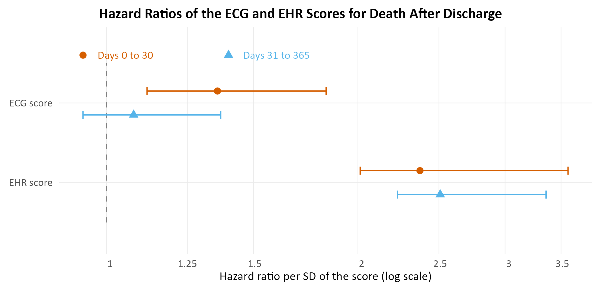
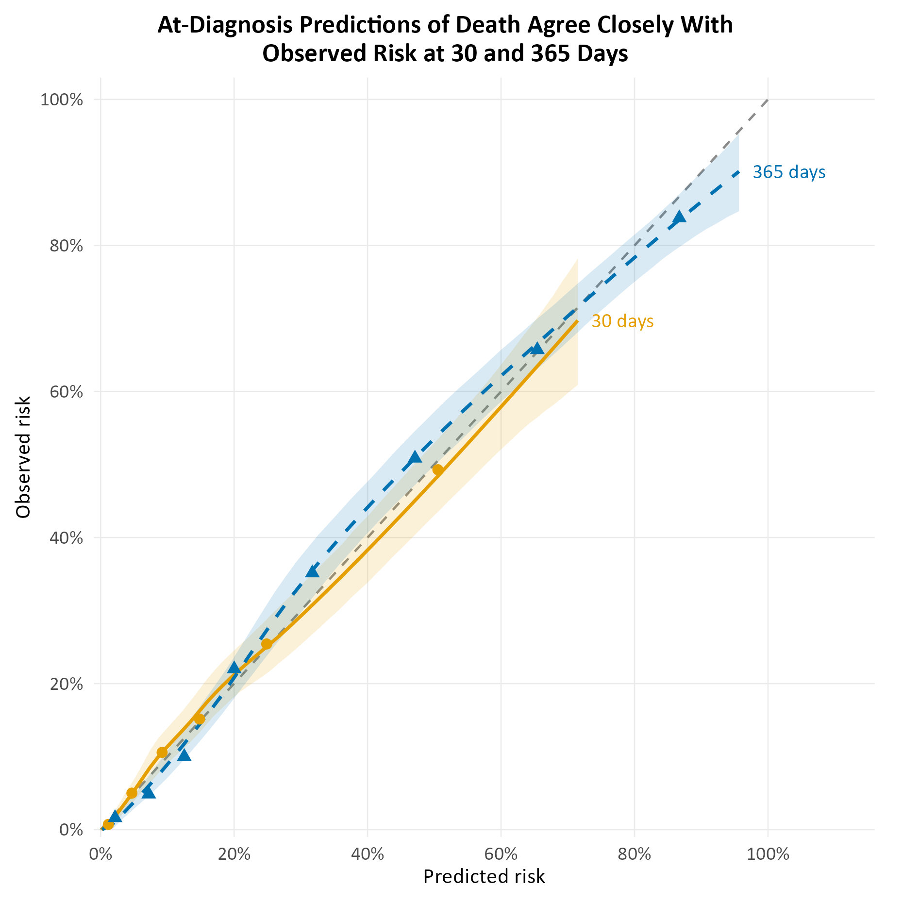
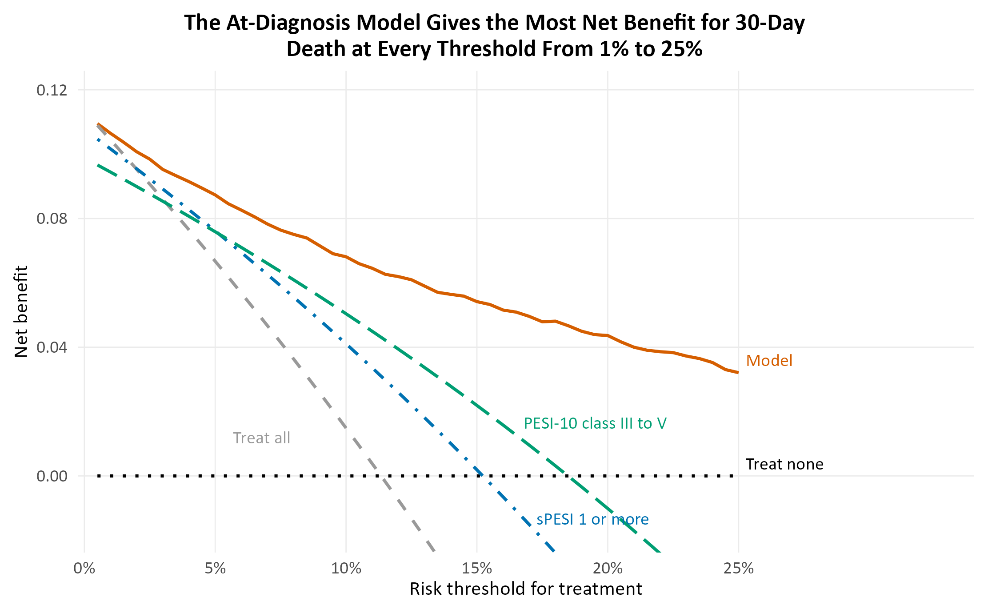
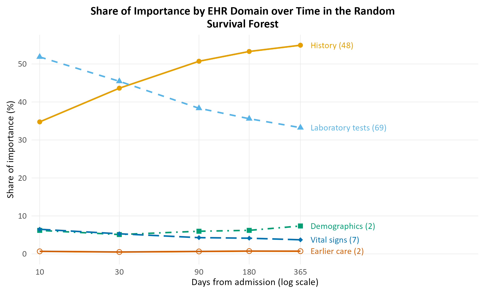

# Multimodal Prediction of Death and Readmission After Pulmonary Embolism

Development in MIMIC-IV and bidirectional transfer of death models with Stanford INSPECT. Post-dissertation project, 2026, and the third in a series:

1. [pe-multimodal-prognosis-msc](https://github.com/andmahoff/pe-multimodal-prognosis-msc): MSc Data Science dissertation, binary 30-day outcomes after acute pulmonary embolism (PE) from EHR, ECG and CTPA report features.
2. [pe-fusion-transfer](https://github.com/andmahoff/pe-fusion-transfer): side project on fusion architectures and transfer between INSPECT and MIMIC-IV.
3. **pe-survival-prognosis** (this repository): the same patients re-analysed as time-to-event data, at diagnosis and at discharge, for up to one year.

This repository holds the analysis code, the registration documents, the aggregate result tables and the figures. It is research code shared for transparency and reproducibility, not a maintained software package. It contains no patient-level data.

## Summary

The dissertation predicted fixed 30-day outcomes. This project treats the same outcomes as events in time, so that one model gives a risk at any horizon and can say when risk is concentrated. It asks:

1. **Primary, registered question (H1).** After discharge, is the ECG's prognostic signal for death concentrated in the first 30 days?
2. **How well can death and readmission be predicted at diagnosis and at discharge?** Survival super learners over EHR, ECG and CTPA report features, at 10, 30, 90, 180 and 365 days, compared with sPESI, PESI-10 and the EHR alone.
3. **Does a survival model beat a binary model trained for each horizon?**
4. **Do death models transfer between hospitals?** EHR and CTPA ridge-Cox models moved between MIMIC-IV and INSPECT in both directions, read through the Debray framework.

The analysis plan was registered before any model was fitted (30 September 2026). H1 is the only confirmatory analysis. Everything else is secondary or exploratory. Each later analysis was specified in a dated addendum (A1 to A37) before it was run, and the last addendum (A38) sets out the final tables and figures, which fit no new model (see [Registration and audit trail](#registration-and-audit-trail)).

**In brief:**

1. **H1 is supported.** Per standard deviation of the ECG score, the hazard ratio for death was 1.36 (1.12 to 1.83) in days 0 to 30 after discharge and 1.08 (0.94 to 1.37) in days 31 to 365. Their ratio, the registered estimand, was 1.26 (1.06 to 1.51).
2. **The models discriminate well and are well calibrated internally.** For death by 30 days the AUROC was 0.867 at diagnosis and 0.925 at discharge, with observed/expected ratios of 0.99 to 1.00.
3. **They clearly beat the clinical scores, but the ECG and CTPA add little to the EHR.** At diagnosis the AUROC gain for 30-day death was 0.147 over sPESI and 0.102 over PESI-10, against 0.006 over the EHR alone.
4. **Survival and binary models performed almost the same.** In 32 of 40 pipeline, outcome and horizon cells their AUROCs were within 0.01.
5. **Transfer costs about 0.02 AUROC and a large calibration shift.** Moving the EHR and CTPA death model between MIMIC-IV and INSPECT lost 0.022 and 0.020 AUROC at one year. Observed/expected ratios of 0.62 and 1.64 returned to 1.03 and 1.00 after only the baseline risk was updated.

## Cohorts and outcomes

Data: MIMIC-IV v3.1 (Beth Israel Deaconess Medical Center, 2008 to 2022) for development, and Stanford INSPECT for the transfer analysis. PE was identified by ICD-10 I26 and ICD-9 415.1.

| Pipeline | Cohort | Size | Deaths by 30 days | Deaths by 365 days |
|---|---|---|---|---|
| At diagnosis (clock at admission) | EHR+ECG | 3,501 admissions (3,160 patients) | 397 (11.3%) | 971 (27.7%) |
| At diagnosis | with a presentation CTPA | 1,636 admissions | 152 (9.3%) | 420 (25.7%) |
| At discharge (first admission per patient, alive at discharge) | EHR+ECG | 2,909 discharges | 177 (6.1%) | 620 (21.3%) |
| At discharge | with a CTPA | 1,405 discharges | 79 (5.6%) | 292 (20.8%) |
| Transfer, MIMIC-IV side | first admissions with a CTPA | 1,490 patients | 132 (8.9%) | 369 (24.8%) |
| Transfer, INSPECT side | PE-positive persons, clock at the index CTPA | 3,300 persons | 250 (7.8%) | 539 (17.5%) |

INSPECT percentages are Kaplan-Meier risks, because INSPECT follow-up is censored when patients leave Stanford care.

Outcomes: death; death or cardiovascular (CV) readmission (the composite); and CV readmission with death as a competing event. CV readmission is a later admission coded for myocardial infarction, heart failure, cardiac arrest, atrial fibrillation or ischaemic stroke (I21, I22, I50, I46, I48, I63; 410, 428, 427.5, 427.3, 433, 434).

Modalities:

- **EHR.** At diagnosis, 128 features known at presentation: demographics, first vital signs, first laboratory tests, history from diagnosis codes, and earlier care. At discharge, the dissertation's 28 features, a 79-feature version, and "EHR+" (139 features, adding diagnosis codes, discharge destination and further measurements).
- **ECG.** At discharge, 264 features (71 SCP-ECG statement logits and 193 waveform measurements). At diagnosis, the first ECG within 24 hours of admission (169 features).
- **CTPA.** 46 features extracted from the radiology report text with regular expressions and negation handling; 38 of them are shared with INSPECT.

## Methods in short

- **Level 1.** For each modality, out-of-fold risk scores from ridge-penalised Cox, penalised-spline Cox (EHR), random survival forests and oblique random survival forests, tuned by inner cross-validation. Cause-specific versions for CV readmission. Also tried and reported: elastic net, CoxBoost, DeepSurv and DeepHit, and matched binary learners at each horizon.
- **Fusion.** A survival super learner over candidate stacks (Kaplan-Meier, single modalities, and proportional-hazards, time-varying and time-varying-coefficient Cox stacks of the modality scores). Weights are non-negative and sum to one, fitted on inner out-of-fold predictions, followed by logistic recalibration at each horizon.
- **Validation.** 5-fold StratifiedGroupKFold, grouped by patient, repeated with six seeds (42, 7, 13, 1, 2, 3) and averaged. 95% intervals from 2,000 patient-clustered bootstrap samples.
- **Measures.** Time-dependent AUROC with inverse probability of censoring weights, index of prediction accuracy (IPA, a scaled Brier score), observed/expected ratio against Kaplan-Meier risk, calibration slope and intercept, integrated calibration index, and decision curves.
- **Temporal validation.** The whole pipeline refitted on admissions from 2010 to 2013 and tested on 2014 onwards (MIMIC-IV dates are shifted, so years are approximate).

## Key results

All numbers below are copied from [`results/verified_results.md`](results/verified_results.md), which `scripts/13e_verified_results.py` builds from the saved tables, and from the S6 tables (`results/s6_*.csv`). Intervals are 95% bootstrap intervals.

### Registered primary analysis (H1)

Frame B (at discharge), EHR+ECG cohort, 2,909 discharges, death split at day 30. The ECG's early-to-late hazard ratio ratio was 1.26 (1.06 to 1.51), so H1 is supported. The EHR showed no such pattern (0.95, 0.83 to 1.13). The ratio stayed between 1.23 and 1.32 when the scores were winsorised or rank-normalised, when hospice discharges were excluded, and when the EHR score was retuned or enlarged. In the smaller three-modality cohort it was 1.25 (0.96 to 1.63), with an interval that includes 1.

<p align="center">
  
</p>

*Hazard ratio for death per standard deviation of the ECG and EHR scores in days 0 to 30 and days 31 to 365 after discharge (2,909 discharges), with 95% patient-level bootstrap intervals from 2,000 refits.*

### Final models

Death at diagnosis uses Super learner P and death at discharge uses Super learner v7. The composite and CV readmission use the stage 18r super learners. AUROC (95% interval), EHR+ECG cohort:

| Pipeline | Outcome | 30 days | 365 days |
|---|---|---|---|
| At diagnosis | Death | 0.867 (0.850 to 0.884) | 0.889 (0.877 to 0.901) |
| At diagnosis | Death or CV readmission | 0.845 (0.828 to 0.861) | 0.874 (0.861 to 0.887) |
| At diagnosis | CV readmission (death competing) | 0.790 (0.758 to 0.821) | 0.799 (0.777 to 0.820) |
| At discharge | Death | 0.925 (0.907 to 0.940) | 0.900 (0.888 to 0.913) |
| At discharge | Death or CV readmission | 0.870 (0.851 to 0.887) | 0.879 (0.866 to 0.892) |
| At discharge | CV readmission (death competing) | 0.837 (0.811 to 0.862) | 0.839 (0.819 to 0.857) |

Observed/expected ratios were 0.98 to 1.00 and calibration slopes 1.00 to 1.06 for every outcome and horizon in this cohort. Results for all five horizons and the three-modality cohort are in Tables 2 and S2 of `verified_results.md`.

<p align="center">
  
</p>

*Calibration of the at-diagnosis model for death at 30 and 365 days after admission (3,501 admissions). Lines are loess calibration curves with 95% patient-clustered bootstrap bands; points are deciles of predicted risk, merged from the lowest until each holds at least 10 events.*

**Against the clinical scores (death at diagnosis, 30 days).** sPESI had an AUROC of 0.720 (0.696 to 0.743) and PESI-10 0.765 (0.743 to 0.787). The model's gain was 0.147 (0.126 to 0.169) over sPESI and 0.102 (0.084 to 0.121) over PESI-10. At sPESI's sensitivity, its specificity was 0.246 (0.151 to 0.296) higher.

**Against the EHR alone.** In this cohort, adding the ECG to the EHR raised the AUROC by at most 0.016 for any outcome and horizon. For death at diagnosis the gain was 0.006 (0.001 to 0.011) at 30 days.

**Decision curves.** For 30-day death at diagnosis the model gave more net benefit than treating everyone, sPESI or PESI-10 at every threshold from 1% to 25%.

<p align="center">
  
</p>

*Decision curves for death within 30 days of admission: the at-diagnosis model against treating everyone, treating no one, sPESI 1 or more, and PESI-10 class III to V (3,501 admissions; 11.3% died).*

### Other findings

- **Hospice discharges.** Part of the at-discharge model's accuracy for death comes from the discharge destination. Without the hospice indicator the 30-day AUROC fell by 0.016 (0.009 to 0.024). With hospice discharges left out, the final model's 30-day AUROC was 0.897 (0.875 to 0.919).
- **Temporal validation.** Refitted on 2010 to 2013 and tested on 2014 onwards, the at-diagnosis death model kept its discrimination (AUROC 0.861 at 30 days, 0.887 at 365 days), but its 30-day risks were too high (observed/expected 0.89, 0.80 to 0.99). Risks of CV readmission were overestimated in the later years (observed/expected 0.69 to 0.82 at 30 to 365 days).
- **What drives the at-diagnosis model.** In the random survival forest, laboratory tests held 52% of the importance at 10 days and history 35%; by 365 days history held 55% and laboratory tests 33%.
- **The CTPA report.** Its prognostic signal came mainly from incidental findings and comorbidity mentioned in the report, not from the PE itself. On their own, the right-heart strain signs had a 30-day AUROC of 0.495 (0.451 to 0.543) in the three-modality cohort.
- **Subgroups.** At discharge the 30-day AUROC was 0.953 under 65 and 0.842 at 80 and over.

<p align="center">
  
</p>

*Share of SurvSHAP(t) importance held by each EHR domain at each horizon in the random survival forest at diagnosis. The number of features in each domain is in brackets.*

### Transfer between MIMIC-IV and INSPECT (S6)

The S6 analysis moved the EHR and CTPA ridge-Cox death model, built on the 28 EHR and 38 CTPA features both datasets share, between the two hospitals. A membership model could tell the two cohorts apart almost perfectly (AUROC 0.995), and one-year mortality differed (Kaplan-Meier 17.5% in INSPECT, 24.8% in MIMIC-IV).

| Direction (death by 365 days) | Transferred AUROC | Refitted in target | Loss | Observed/expected, transferred | After baseline update |
|---|---|---|---|---|---|
| MIMIC-IV to INSPECT | 0.792 (0.772 to 0.811) | 0.814 (0.795 to 0.834) | 0.022 (0.012 to 0.033) | 0.62 (0.57 to 0.67) | 1.03 (0.95 to 1.11) |
| INSPECT to MIMIC-IV | 0.869 (0.848 to 0.889) | 0.889 (0.872 to 0.907) | 0.020 (0.009 to 0.032) | 1.64 (1.49 to 1.78) | 1.00 (0.91 to 1.08) |

Discrimination largely survived the move, while calibration did not: each model carried its own hospital's baseline risk. Re-estimating only the baseline hazard in the target restored calibration.

## Registration and audit trail

The [`docs`](docs) folder holds:

- `PREREGISTRATION.md`: the plan, with H1 and its decision rule, registered before any model was fitted.
- `PREREGISTRATION_ADDENDUM.md` and `PREREGISTRATION_ADDENDUM_2.md`: addenda A1 to A37, each committed before the analysis it specifies, and A38, which sets out the final tables and figures and was committed with them.
- `DEVIATIONS.md`: deviations D1 to D19 from the plan, with reasons.
- `registration_log.md`: the dated commit history of the local repository in which the work was done.
- `suppressed_cells.csv`: every result cell changed by the small-cell rule (see below).

The local repository was never pushed, so its dates cannot be checked independently. This public repository was created afresh from its final state, with tidied comments; `registration_log.md` explains exactly what differs.

Scripts cite their registration item in the header (for example `PREREGISTRATION.md, section 5` or `A32`), so each result can be traced back to the text that specified it. Earlier versions of some analyses (super learners v1 to v6, for example) are kept because the addenda refer to them.

## Data access

No data are included. The analyses need credentialed access to:

- [MIMIC-IV](https://physionet.org/content/mimiciv/) v3.1, [MIMIC-IV-ECG](https://physionet.org/content/mimic-iv-ecg/) v1.0, [MIMIC-IV-ED](https://physionet.org/content/mimic-iv-ed/) v2.2 (triage vital signs) and [MIMIC-IV-Note](https://physionet.org/content/mimic-iv-note/) v2.2 (radiology reports) on PhysioNet, with MIMIC-IV also queried on Google BigQuery;
- [INSPECT](https://aimi.stanford.edu/datasets/inspect-Multimodal-Dataset-for-Pulmonary-Embolism-Diagnosis-and-Prognosis) from the Stanford Center for Artificial Intelligence in Medicine and Imaging, under its data use agreement ([Huang et al., NeurIPS 2023](https://proceedings.neurips.cc/paper_files/paper/2023/hash/39736af1b9d87a1fddad9f84a6bcf64c-Abstract.html)).

The modality matrices and cohorts were built by the dissertation and side-project pipelines and frozen by `scripts/01_export_inputs.py`. Without those inputs the scripts cannot be rerun, but `results/` holds the aggregate tables they produced, apart from logs and three tables withheld under the small-cell rule (listed in [`results/README.md`](results/README.md)).

## Running the code

The scripts expect this repository in a folder named `SurvivalProject`, next to the dissertation (`Dissertation`) and side-project (`SideProject`) folders, and are run from inside it:

```
git clone https://github.com/andmahoff/pe-survival-prognosis SurvivalProject
cd SurvivalProject
Rscript scripts/07_primary.R
```

Environment variables:

- `PROJECTS_DIR`: the folder that holds `SurvivalProject`, `SideProject` and `Dissertation`. If unset, the parent of the working directory is used.
- `GCP_PROJECT`: the Google Cloud billing project for the BigQuery scripts (`00r` and `03` to `03e`).

Most R scripts accept `--probe-only` (a timing probe that stops before the full run), and the parallel ones `--workers=N`. Each script's header lists its inputs, outputs and options. Patient-level intermediate files are written under `data/` and are excluded by `.gitignore`; only aggregates go to `results/`.

Software used: R 4.5.2 with survival 3.8.3, glmnet 5.1, randomForestSRC 3.9.0, riskRegression 2026.3.11, data.table 1.18.0 and future.apply 1.20.1 (`scripts/00_r_packages.R` installs the rest); Python with the versions in `requirements.txt`.

### Scripts by stage

| Stage | Scripts | What they do |
|---|---|---|
| Set-up and inputs | `00*`, `01`, `02`, `03*` | packages, inventories, frozen inputs, event-time audit, BigQuery pulls |
| Frames and gates | `04*`, `05*` | analysis frames and folds, registered gates before any analysis |
| Level 1 | `06*`, `10_deep.py`, `p2_nn.py`, `tune_expand.R` | out-of-fold scores for each modality and learner |
| Primary analysis | `07*` | H1 and its sensitivity analyses |
| Registered secondary analyses | `08`, `09*`, `11*`, `12` | late fusion, competing risks, calibration, learner families, sensitivity |
| Tables and figures | `13*` | Table 1, Tables 2 and 3, final calibration and decision curves, verified results |
| Addenda | `14*` to `22*` | time-varying effects, decision curves, stability, conformal bounds, transfer (S6 in `16b`), CTPA blocks, fusion architectures, super learners (`18f` to `18s`), interpretability, temporal validation, subgroups |
| Provenance | `provenance/` | copies of the two side-project files that `01_export_inputs.py` rebuilds the inputs from; not run here |

## Repository contents

```
scripts/      analysis scripts (R and Python), numbered by stage
provenance/   side-project code used to rebuild the frozen inputs
results/      aggregate result tables (CSV, two Excel tables) and verified_results.md
figures/      figures written by 13d, 20b and 20q (the scripts write them to "R Graphs/")
docs/         registration documents, registration log and the suppressed-cell list
tools/        suppress_small_cells.py, run on results/ before publication
```

## Small cells

Counts of 1 to 9 patients or events are shown as `<10`. Where a set of cells adds up to a known total and only one was small, a second cell is shown as `suppressed` (`†` in Table 1) so the first cannot be worked out by subtraction. Rates from those counts are left blank, and shares that would give 1 to 9 patients are shown as `suppressed`. Three tables from which small counts could be recovered in many rows are not published. `tools/suppress_small_cells.py` applied these rules to the results folder before publication, and `docs/suppressed_cells.csv` lists every change. All other cells are exactly as the scripts wrote them.

The registration documents are copied unchanged. A few sentences in `DEVIATIONS.md` mention one or two patients with extreme or failed model scores; they describe model fitting, not any patient's characteristics or outcome.

## Limitations

- Development used one hospital. Only the EHR and CTPA death model was tested in a second hospital (S6); the final super learners were validated internally and temporally, not externally.
- Most addenda were written after earlier results had been seen. Each was committed before the analysis it specifies, but the set of analyses grew with the results, so only H1 is confirmatory.
- At discharge, part of the accuracy for death reflects the decision to discharge to hospice.
- CTPA features come from report text, not from the images.
- MIMIC-IV dates are shifted per patient, so calendar years in the temporal validation are approximate.
- Some subgroups were small: below 10 deaths, no AUROC was estimated.

## Citation

To cite this code, use [`CITATION.cff`](CITATION.cff).

## Licence

Code: MIT (see [`LICENSE`](LICENSE)). The data remain under their own licences and data use agreements.
